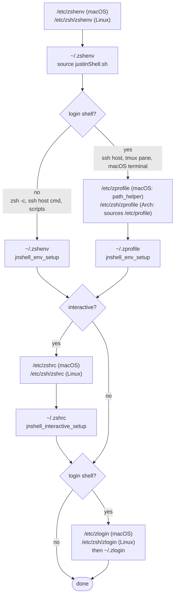

# Shell setup

## Premise

Every script in this directory assumes the dotfiles repo is checked out at
`$HOME/.dotfiles`. Paths inside the scripts are hard-coded against that
location. If the repo lives somewhere else, things will not work.

## Shell compatibility

Everything is intended to be compatible with both **bash** and **zsh** unless
explicitly noted.

## Entry-point chain

Startup is split into two phases, both defined in `shell/justinShell.sh`:

- `jnshell_env_setup`: environment for **every** shell, including
  non-interactive ones (scripts, ssh, etc). PATH, toolchains, and
  `~/.localshell`. Produces no output in non-interactive shells.
- `jnshell_interactive_setup`: aliases, functions, and prompt for interactive
  shells.

Ansible installs the `~/` symlinks below.

```
~/.zshenv -> shell/zshenv        (every zsh)
    |--- source shell/justinShell.sh
    '--- jnshell_env_setup         (non-login shells only)

~/.zprofile -> shell/zprofile    (login zsh, after /etc/zprofile)
    '--- jnshell_env_setup

~/.zshrc -> shell/zshrc          (interactive zsh, after ~/.zprofile)
    '--- jnshell_interactive_setup

~/.bashrc -> shell/bashrc        (bash)
    |--- source shell/justinShell.sh
    |--- jnshell_env_setup
    '--- jnshell_interactive_setup (interactive only)

jnshell_env_setup
    |--- ~/.local/bin, shell/git-mv-changes on PATH
    |--- shell/modules/macports.sh  (only on Darwin)
    |--- ~/.localshell              (per-host overrides, OPTIONAL)
    |--- shell/modules/rust.sh      (if JNSHELL_USE_RUST=true)
    '--- shell/modules/opener.sh    (if JNSHELL_USE_OPENER=true)

jnshell_interactive_setup
    |--- shell/path_utils.sh, shell/bazel_utils.sh
    |--- shell/modules/common_aliases.sh  (DEFAULT ON)
    |--- shell/modules/git_aliases.sh     (DEFAULT ON)
    |--- shell/fzf_aliases.sh       (if fzf is installed)
    |--- shell/modules/ssh_socket.sh  (if JNSHELL_LONG_LIVED_REMOTE=true)
    |--- shell/modules/nvm.sh       (if JNSHELL_USE_NVM=true)
    '--- shell/modules/prompt.sh    (always; dispatches on JNSHELL_PROMPT)
```

`shell/justinShell.sh` also sources `shell/jnshell_utils.sh` (warn / flag /
require / PATH helpers) when it is loaded.

### zsh file call order



zsh login shells run `/etc/zprofile` after `~/.zshenv`. On macOS it runs
`path_helper`, which moves the system directories to the front of PATH, so
login shells defer `jnshell_env_setup` to `~/.zprofile`, which runs after it.
Each zsh runs `jnshell_env_setup` exactly once. Nested shells inherit PATH and
run it again; the PATH helpers `jnshell_path_prepend` / `jnshell_path_append`
keep that from duplicating entries.

## Per-host overrides

Copy `shell/localshell.example` to `~/.localshell` and uncomment / edit the
lines you want. The file is gitignored implicitly (it lives in `$HOME`, not in
the repo) so per-host settings don't leak across machines.

`~/.localshell` is sourced by `jnshell_env_setup` **before** any feature
module, so flags and variables set there take effect for the rest of startup.
It is read by every shell, including non-interactive ones, so keep it fast and
free of output.

## Feature flags

Every flag is read from `~/.localshell`. A flag is "enabled" when its value is
the literal string `true`. Each gated feature verifies its own prerequisites;
if anything is missing you get a warning on stderr in interactive shells and
the feature is skipped - the shell still starts.

See the example file `shell/localshell.example` for the full list of feature
flags and their description.

## Linting

Shell scripts in this repo are linted with shellcheck. See
[`utils/shellcheck/README.md`](../utils/shellcheck/README.md) for how to run
the linter and how to wire it as a pre-commit hook.
